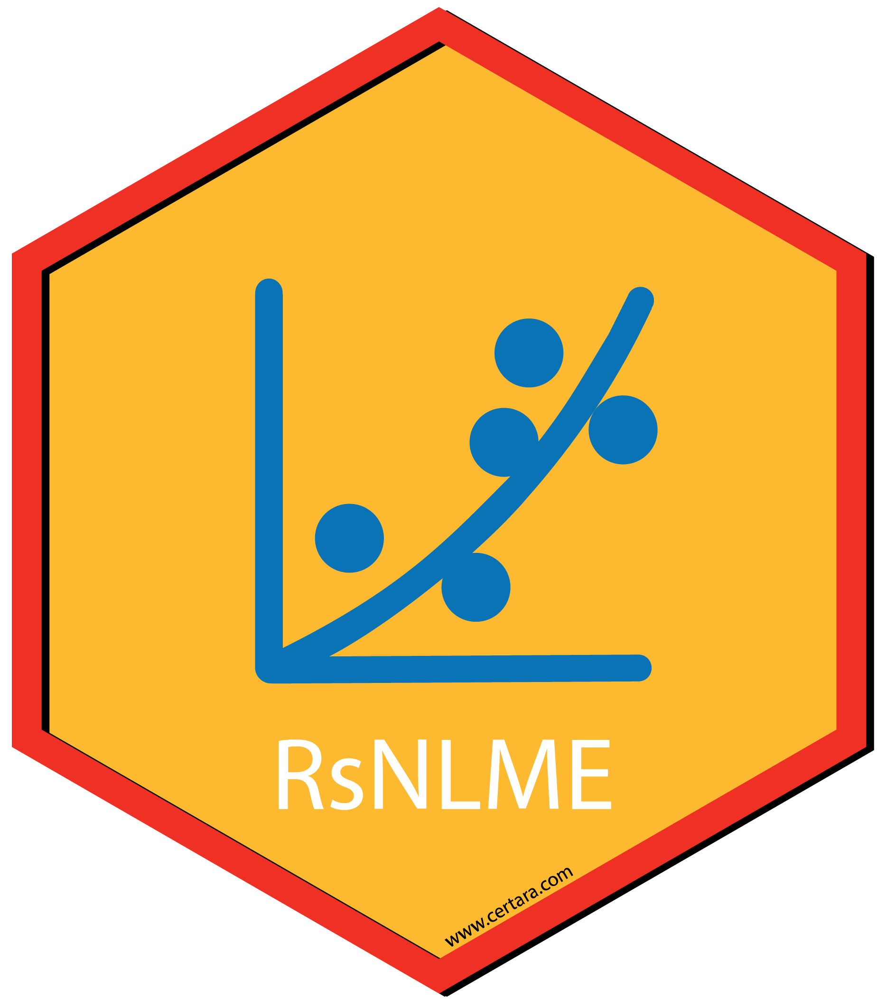

# News

## RsNLME 

### v3.2.0

- Date: 2026/09
- [Release
  Notes](https://certara.github.io/R-RsNLME/articles/release_notes.html#rsnlme-3-2-0---september-2026)

------------------------------------------------------------------------

### v3.1.1

- Date: 2026/03/18
- [Release
  Notes](https://certara.github.io/R-RsNLME/articles/release_notes.html#rsnlme-3-1-1---march-2026)

------------------------------------------------------------------------

### v3.1.0

- Date: 2025/08/22
- [Release
  Notes](https://certara.github.io/R-RsNLME/articles/release_notes.html#rsnlme-3-1-0---august-2025)

------------------------------------------------------------------------

### v3.0.0

- Date: 2024/09
- [Release
  Notes](https://certara.github.io/R-RsNLME/articles/release_notes.html#rsnlme-3-0-0---september-2024)

------------------------------------------------------------------------

### v2.0.1

- Date: 2024/05
- [Release
  Notes](https://certara.github.io/R-RsNLME/articles/release_notes.html#rsnlme-2-0-1---may-2024)

------------------------------------------------------------------------

### v2.0.0

- Date: 2023/11
- [Release
  Notes](https://certara.github.io/R-RsNLME/articles/release_notes.html#rsnlme-2-0-0---november-2023)

------------------------------------------------------------------------

### v1.2.0

- Date: 2023/1/30
- [Release
  Notes](https://certara.github.io/R-RsNLME/articles/release_notes.html#rsnlme-1-2-0---january-2023)

------------------------------------------------------------------------

### v1.1.0

- Date: 2021/11/01
- [Release
  Notes](https://onlinehelp.certara.com/rsnlme/1.1/index.html#t=RsNLME_User_Guide%2FRsNLMEReleaseNotes%2FRsNLMEReleaseNotes.htm%23XREF_56808__RsNLME_1_1_Release_Notes6831)

------------------------------------------------------------------------

## Pirana 

### v25.7.1

- Date: 2025/08/08
- [Release Notes](https://onlinehelp.certara.com/pirana/25.7/index.html)

------------------------------------------------------------------------

### v24.9.3

- Date: 2024/09
- [Release Notes](https://onlinehelp.certara.com/pirana/24.9.1/index.html#t=Pirana_User_Guide%2FcontentPirana%2FcontentPirana.htm)

------------------------------------------------------------------------

### v23.10.2

- Date: 2023/12
- [Release Notes](https://onlinehelp.certara.com/pirana/23.10.1/index.html)

------------------------------------------------------------------------

### v23.1.1

- Date: 2023/1/30
- [Release
  Notes](https://onlinehelp.certara.com/pirana/23.1.1/index.html#t=Pirana_User_Guide%2FPiranaReleaseNotes%2FPiranaReleaseNotes.htm%231009015&rhtocid=_2)

------------------------------------------------------------------------

### v21.11.1

- Date: 2021/11/01
- [Release
  Notes](https://onlinehelp.certara.com/pirana/21.11.1/index.html#t=Pirana_User_Guide%2FPiranaReleaseNotes%2FPiranaReleaseNotes.htm%23XREF_56958__Pirana_21_11_1_Release_Notes5608)

------------------------------------------------------------------------
